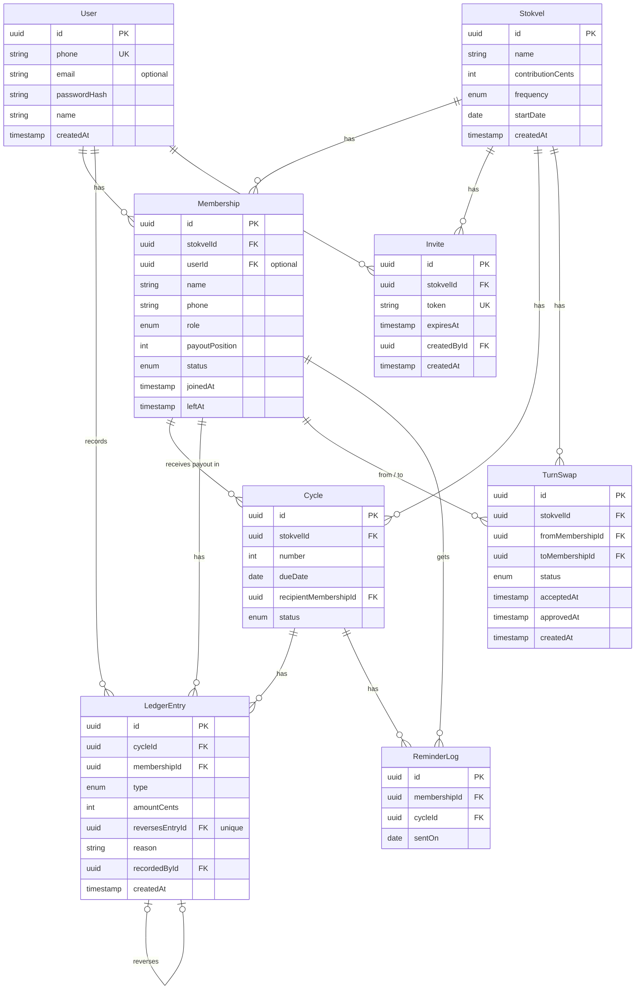

# Database design

The database has 8 tables. Money only lives in the ledger, and balances and statuses are calculated from it, never stored.

## ERD

## Tables

| Table | What it stores | Key fields | Supports |
| --- | --- | --- | --- |
| User | A person who can log in | phone (unique), email (optional), passwordHash, name | US-01 |
| Stokvel | A savings group and its rules | name, contributionCents, frequency, startDate | US-02 |
| Membership | A person's place in one stokvel, with or without a login | stokvelId, userId (optional), name, phone, role, payoutPosition, status, joinedAt, leftAt | US-03, 04, 05; rules 1, 3, 6 |
| Invite | A join link for members who want a login | stokvelId, token (unique), expiresAt | US-03 |
| Cycle | One month of the stokvel | stokvelId, number, dueDate, recipientMembershipId, status | US-08, 09; rule 5 |
| LedgerEntry | Every money record, never edited | cycleId, membershipId, type, amountCents, reversesEntryId, reason, recordedById | US-06, 07, 08; rule 2 |
| TurnSwap | A request to swap payout turns | fromMembershipId, toMembershipId, status, acceptedAt, approvedAt | Rule 4 |
| ReminderLog | Reminder emails already sent | membershipId, cycleId, sentOn | US-10 |

Enum values:

- Stokvel.frequency: MONTHLY
- Membership.role: CHAIRPERSON, TREASURER, MEMBER
- Membership.status: ACTIVE, LEFT
- Cycle.status: OPEN, PAID_OUT
- LedgerEntry.type: CONTRIBUTION, PAYOUT, REVERSAL
- TurnSwap.status: PENDING, ACCEPTED, APPROVED, REJECTED

## Design decisions

Each of these becomes a short ADR (decision record) in the repo.

1. **Money is stored as whole cents (Int).** R500.00 is saved as 50000. Floats cause rounding errors with money, for example 0.1 + 0.2 = 0.30000000000000004.
2. **The ledger is append-only.** The API never updates or deletes a LedgerEntry. A mistake is fixed with a REVERSAL entry that points to the wrong entry through reversesEntryId. That field is unique, so an entry can only be reversed once.
3. **Amounts are always positive; the type gives the direction.** CONTRIBUTION adds to the pot, PAYOUT takes from it, and REVERSAL cancels the entry it points to.
4. **Balances and statuses are calculated, not stored.** "Paid", "owes R200" and "late" come from summing ledger entries against the contribution and due date. This means there's one source of truth that can't drift out of sync.
5. **Members are never deleted.** Leaving sets status to LEFT and fills leftAt, so their history and what they owe stay visible (rule 3).
6. **Payout swaps run in a database transaction.** Both memberships' payoutPosition change together or not at all (rule 4). payoutPosition is not a unique column, so a swap can't hit a unique-key clash halfway; the service checks positions are unique instead.
7. **ReminderLog has a unique key on (membershipId, cycleId, sentOn).** The database itself blocks a second reminder on the same day, even if the job runs twice (US-10).
8. **People are identified by phone number, and a login is optional.** Membership stores the member's own name and phone, so the treasurer can add someone who will never log in. If that person later signs up with the same number, their User account is linked to the membership. Numbers are saved in one format (082 123 4567 becomes +27821234567) so the same person always matches.
